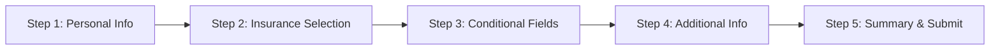

# Implementation Plan: Formulario de Cotización

## Executive Summary

This document outlines the comprehensive implementation plan for adding a "Formulario de Cotización" (Quote Form) to the "Clientes" section of the Proense Asesora Digital website. The implementation will follow the same multi-step form pattern, safety principles, and architecture as the existing emission form while adapting fields to collect quotation information for all insurance types.

---

## 1. Project Overview

### Purpose
Create a unified quote request form that allows clients to request insurance quotes for different types of insurance products (vida, auto, hogar, salud, mascotas) through a single, streamlined interface.

### Location
- **Navigation Path**: Clientes → Cotización de Seguros
- **URL Route**: `/clientes/cotizacion`
- **Component Directory**: `/src/components/forms/cotizacion/`

### Insurance Types Covered
Based on the HTML forms analyzed in `docs/cotizacion/`:
1. **Seguro de Vida** (Life Insurance)
2. **Seguro de Auto** (Auto Insurance)
3. **Seguro de Hogar** (Home Insurance)
4. **Seguro de Salud** (Health Insurance)
5. **Seguro de Mascotas** (Pet Insurance)

---

## 2. Technical Architecture

### Form Structure Pattern (Following Emision Form)

```
src/
├── components/
│   └── forms/
│       └── cotizacion/
│           ├── MultiStepQuoteForm.tsx       # Main form controller
│           ├── formSchema.ts                # Zod validation schema
│           ├── NumberedProgressBar.tsx      # Progress indicator (reusable)
│           ├── Step1_PersonalInfo.tsx       # Personal information
│           ├── Step2_InsuranceSelection.tsx # Insurance type selection
│           ├── Step3_ConditionalFields.tsx  # Dynamic fields per insurance type
│           ├── Step4_AdditionalInfo.tsx     # Additional information
│           └── Step5_Summary.tsx            # Review and submit
```

### Multi-Step Flow



---

## 3. Form Fields Specification

### Step 1: Personal Information (Common for All)
All fields extracted from HTML forms show consistent personal information requirements:

```typescript
interface Step1Fields {
  // Basic Information
  firstName: string;           // "Nombre" - Required
  lastName: string;            // "Apellido" - Required
  birthDate: {                 // "Fecha de nacimiento" - Required
    day: string;
    month: string;
    year: string;
  };

  // Contact Information
  phoneNumber: string;         // "Número de teléfono" - With country selector
  email: string;               // "Correo electrónico" - Required

  // Identification & Location
  cedula: string;              // "Número de cédula" - Required
  city: string;                // "Ciudad" - Required
  address: string;             // "Dirección" - Required

  // Employment & Financial (Common across forms)
  employmentStatus: string;    // "Situación laboral" - Dropdown
  monthlyIncome?: string;      // "Ingresos mensuales estimados" (Vida)
  maritalStatus?: string;      // "Estado Civil" (Vida)
  hasChildren?: boolean;       // "¿Tienes hijos?" (Vida)
}
```

### Step 2: Insurance Type Selection

```typescript
interface Step2Fields {
  insuranceType: 'vida' | 'auto' | 'hogar' | 'salud' | 'mascotas';
  coverageAmount?: string;     // Optional: desired coverage amount
  startDate?: string;          // When coverage should start
}
```

### Step 3: Conditional Fields (Dynamic per Insurance Type)

#### 3.1 Seguro de Vida (Life Insurance)
```typescript
interface VidaFields {
  // From analyzed forms - specific to life insurance
  monthlyIncome: string;       // "Ingresos mensuales estimados"
  maritalStatus: string;       // "Estado Civil"
  hasChildren: 'si' | 'no';    // "¿Tienes hijos?"
  numberOfChildren?: string;   // If hasChildren === 'si'
  beneficiaries?: string;      // Names and percentages
  healthConditions?: string;   // Pre-existing conditions
}
```

#### 3.2 Seguro de Auto (Auto Insurance)
```typescript
interface AutoFields {
  // Standard auto insurance fields (not in provided HTML but standard)
  vehicleMake: string;         // Marca del vehículo
  vehicleModel: string;        // Modelo
  vehicleYear: string;         // Año
  licensePlate?: string;       // Placa
  vehicleUse: string;          // Personal/Commercial
  parkingType: string;         // Garage/Street
  dailyKilometers?: string;    // Daily usage
}
```

#### 3.3 Seguro de Hogar (Home Insurance)
```typescript
interface HogarFields {
  propertyType: string;        // Casa/Apartamento
  propertyAddress: string;     // Full property address
  constructionYear?: string;   // Year built
  propertyValue?: string;      // Estimated value
  isOwned: boolean;           // Owner or renting
  hasAlarm?: boolean;         // Security systems
}
```

#### 3.4 Seguro de Salud (Health Insurance)
```typescript
interface SaludFields {
  currentHealthPlan?: string;  // Current insurance if any
  preExistingConditions?: string;
  familyMembers?: Array<{
    name: string;
    age: string;
    relationship: string;
  }>;
  preferredClinics?: string;   // Preferred medical network
}
```

#### 3.5 Seguro de Mascotas (Pet Insurance)
```typescript
interface MascotasFields {
  petType: string;            // Dog/Cat/Other
  petBreed: string;           // Breed
  petAge: string;             // Age
  petName: string;            // Name
  isNeutered: boolean;        // Spayed/Neutered
  hasVaccinations: boolean;   // Up to date on vaccines
  preExistingConditions?: string;
}
```

### Step 4: Additional Information

```typescript
interface Step4Fields {
  previousInsurance: boolean;  // Has had insurance before
  previousInsurer?: string;    // Previous insurance company
  claimsHistory?: string;      // Any previous claims
  additionalComments?: string; // Additional information
}
```

### Step 5: Summary and Consent

```typescript
interface Step5Fields {
  acceptTerms: boolean;        // Terms and conditions
  acceptPrivacy: boolean;      // Privacy policy
  acceptMarketing?: boolean;   // Optional marketing consent
  signature?: string;          // Digital signature (optional)
}
```

---

## 4. Security Implementation

### 4.1 CSRF Protection
Following the existing pattern from emission form:

```typescript
// Frontend implementation
const [csrfToken, setCsrfToken] = useState('');

useEffect(() => {
  const fetchCsrfToken = async () => {
    const response = await fetch('/api/csrf-token', {
      credentials: 'include'
    });
    const data = await response.json();
    setCsrfToken(data.token);
  };
  fetchCsrfToken();
}, []);

// Include in API calls
headers: { 'X-CSRF-Token': csrfToken }
```

### 4.2 Input Sanitization
Server-side sanitization using DOMPurify:

```typescript
import DOMPurify from 'isomorphic-dompurify';

function sanitizeInput(input: string): string {
  return DOMPurify.sanitize(input, {
    ALLOWED_TAGS: [],
    ALLOWED_ATTR: []
  });
}
```

### 4.3 Bot Protection
Honeypot field implementation:

```tsx
{/* Hidden honeypot field */}
<input
  type="text"
  {...register('website')}
  style={{ display: 'none' }}
  tabIndex={-1}
  autoComplete="off"
  aria-hidden="true"
/>
```

### 4.4 File Upload Security
If file uploads are needed (for documents):

```typescript
const fileValidation = {
  maxSize: 5 * 1024 * 1024, // 5MB
  acceptedTypes: [
    'application/pdf',
    'image/jpeg',
    'image/png',
    'image/webp'
  ],
  maxFiles: 5
};
```

### 4.5 Rate Limiting
Implement on API endpoint:

```typescript
// api/send-quote-request.ts
const rateLimiter = {
  windowMs: 15 * 60 * 1000, // 15 minutes
  maxRequests: 5 // 5 requests per window
};
```

---

## 5. Validation Schema (Zod)

### Base Schema Structure

```typescript
// src/components/forms/cotizacion/formSchema.ts
import { z } from 'zod';
import { isValidPhoneNumber } from 'react-phone-number-input';

export const quoteFormSchema = z.object({
  // Step 1: Personal Information
  firstName: z.string()
    .min(1, 'El nombre es requerido')
    .transform(str => str.trim()),

  lastName: z.string()
    .min(1, 'El apellido es requerido')
    .transform(str => str.trim()),

  birthDate: z.object({
    day: z.string().regex(/^(0?[1-9]|[12][0-9]|3[01])$/, 'Día inválido'),
    month: z.string().min(1, 'Mes requerido'),
    year: z.string().regex(/^(19|20)\d{2}$/, 'Año inválido')
  }),

  phoneNumber: z.string()
    .refine(isValidPhoneNumber, { message: 'Número de teléfono inválido' }),

  email: z.string()
    .email('Email inválido')
    .transform(str => str.trim().toLowerCase()),

  cedula: z.string()
    .min(1, 'Número de cédula requerido')
    .regex(/^\d+$/, 'Solo números permitidos'),

  city: z.string().min(1, 'Ciudad requerida'),
  address: z.string().min(1, 'Dirección requerida'),

  employmentStatus: z.enum([
    'empleado',
    'independiente',
    'desempleado',
    'pensionado',
    'estudiante'
  ]),

  // Step 2: Insurance Selection
  insuranceType: z.enum(['vida', 'auto', 'hogar', 'salud', 'mascotas']),

  // Step 3: Conditional fields (validated in superRefine)
  // ... dynamic fields based on insuranceType

  // Step 5: Consent
  acceptTerms: z.boolean()
    .refine(val => val === true, {
      message: 'Debes aceptar los términos y condiciones'
    }),

  acceptPrivacy: z.boolean()
    .refine(val => val === true, {
      message: 'Debes aceptar la política de privacidad'
    }),

  // Honeypot
  website: z.string().optional()
}).superRefine((data, ctx) => {
  // Conditional validation based on insurance type
  // Similar pattern to emission form
});
```

---

## 6. API Integration

### New API Endpoint

```typescript
// api/send-quote-request.ts
export default async function handler(req: Request) {
  // 1. Verify CSRF token
  // 2. Validate honeypot field
  // 3. Sanitize inputs
  // 4. Validate with Zod schema
  // 5. Send to Brevo CRM
  // 6. Send notification emails
  // 7. Return response
}
```

### Email Templates
Create new email templates for quote requests:
- Customer confirmation email
- Internal notification email
- Follow-up email template

---

## 7. Component Implementation Details

### MultiStepQuoteForm.tsx Structure

```tsx
const steps = [
  {
    id: 1,
    name: 'Información Personal',
    fields: ['firstName', 'lastName', 'birthDate', 'phoneNumber', 'email', 'cedula', 'city', 'address', 'employmentStatus']
  },
  {
    id: 2,
    name: 'Tipo de Seguro',
    fields: ['insuranceType', 'coverageAmount', 'startDate']
  },
  {
    id: 3,
    name: 'Detalles del Seguro',
    fields: [] // Dynamic based on insuranceType
  },
  {
    id: 4,
    name: 'Información Adicional',
    fields: ['previousInsurance', 'previousInsurer', 'claimsHistory', 'additionalComments']
  },
  {
    id: 5,
    name: 'Resumen y Envío',
    fields: ['acceptTerms', 'acceptPrivacy', 'acceptMarketing']
  },
];
```

### Dynamic Field Rendering (Step 3)

```tsx
// Step3_ConditionalFields.tsx
const Step3_ConditionalFields = () => {
  const { watch } = useFormContext();
  const insuranceType = watch('insuranceType');

  switch(insuranceType) {
    case 'vida':
      return <VidaFields />;
    case 'auto':
      return <AutoFields />;
    case 'hogar':
      return <HogarFields />;
    case 'salud':
      return <SaludFields />;
    case 'mascotas':
      return <MascotasFields />;
    default:
      return null;
  }
};
```

---

## 8. Navigation Integration

### Update clientServices in Navbar.tsx

```typescript
const clientServices = [
  { name: "Cotización de Seguros", href: "/clientes/cotizacion" }, // NEW
  { name: "Emisión de Pólizas", href: "/clientes/emision-polizas" },
  { name: "Modificaciones", href: "/clientes/modificaciones" },
  { name: "Cancelaciones", href: "/clientes/cancelaciones" },
  { name: "Siniestros y Emergencias", href: "/clientes/siniestros" },
  { name: "Pagos", href: "/clientes/pagos" },
];
```

### Create Route

```tsx
// App.tsx or Routes configuration
<Route path="/clientes/cotizacion" element={<QuotePage />} />
```

### Create Page Component

```tsx
// src/pages/QuotePage.tsx
import MultiStepQuoteForm from '@/components/forms/cotizacion/MultiStepQuoteForm';

const QuotePage = () => {
  return (
    <div className="container mx-auto px-4 py-8">
      <h1 className="text-3xl font-bold mb-6">Solicitud de Cotización</h1>
      <div className="bg-white rounded-lg shadow-md p-6 max-w-4xl mx-auto">
        <MultiStepQuoteForm />
      </div>
    </div>
  );
};
```

---

## 9. Accessibility Requirements

Following WCAG 2.1 AA standards:

### Form Accessibility
- All fields have proper labels and ARIA attributes
- Required fields marked with `aria-required="true"`
- Error messages associated with `aria-describedby`
- Keyboard navigation fully supported
- Focus management between steps

### Progress Indicator
- Step progress announced to screen readers
- Current step indicated with `aria-current="step"`
- Completed steps marked appropriately

### Mobile Optimization
- Touch-friendly controls (min 44px touch targets)
- Responsive layout for all screen sizes
- Optimized for mobile input types (`inputmode`)

---

## 10. Testing Strategy

### Unit Tests
```typescript
// __tests__/formSchema.test.ts
describe('Quote Form Schema', () => {
  test('validates required fields', () => {
    // Test each step's validation
  });

  test('conditional validation works correctly', () => {
    // Test insurance-specific fields
  });
});
```

### Integration Tests
- Form submission flow
- API endpoint integration
- Email delivery verification

### Security Tests
- CSRF token validation
- Input sanitization
- Rate limiting
- File upload restrictions

### Accessibility Tests
- Keyboard navigation
- Screen reader compatibility
- Color contrast ratios
- Focus indicators

---

## 11. Implementation Timeline

### Phase 1: Setup and Base Structure (Days 1-2)
- [ ] Create directory structure
- [ ] Set up base components
- [ ] Configure routing
- [ ] Update navigation

### Phase 2: Form Implementation (Days 3-5)
- [ ] Implement Step 1 (Personal Info)
- [ ] Implement Step 2 (Insurance Selection)
- [ ] Implement Step 3 (Conditional Fields)
- [ ] Implement Step 4 (Additional Info)
- [ ] Implement Step 5 (Summary)

### Phase 3: Validation and Logic (Days 6-7)
- [ ] Create Zod schema
- [ ] Implement conditional validation
- [ ] Add form state management
- [ ] Test validation rules

### Phase 4: API Integration (Days 8-9)
- [ ] Create API endpoint
- [ ] Implement CSRF protection
- [ ] Add input sanitization
- [ ] Set up email templates
- [ ] Integrate with Brevo

### Phase 5: Security and Testing (Days 10-11)
- [ ] Security audit
- [ ] Write unit tests
- [ ] Integration testing
- [ ] Accessibility testing
- [ ] Performance optimization

### Phase 6: Deployment (Day 12)
- [ ] Final review
- [ ] Deploy to staging
- [ ] UAT testing
- [ ] Production deployment

---

## 12. Success Metrics

### Technical Metrics
- Form completion rate > 70%
- Page load time < 2 seconds
- Zero security vulnerabilities
- 100% accessibility compliance

### Business Metrics
- Quote request conversion rate
- Time to quote generation
- Customer satisfaction score
- Error rate < 1%

---

## 13. Maintenance Considerations

### Regular Updates
- Insurance product changes
- Regulatory compliance updates
- Security patches
- Performance optimization

### Monitoring
- Error tracking (Sentry or similar)
- Analytics (form abandonment points)
- Performance monitoring
- Security scanning

### Documentation
- Component documentation
- API documentation
- User guide for staff
- Troubleshooting guide

---

## 14. Risk Mitigation

### Identified Risks
1. **Data Privacy**: Ensure GDPR/local compliance
2. **System Load**: Handle peak traffic periods
3. **Integration Issues**: Third-party API failures
4. **User Experience**: Complex forms may deter users

### Mitigation Strategies
1. Regular security audits and compliance checks
2. Implement caching and rate limiting
3. Fallback mechanisms for API failures
4. Progressive disclosure and save-draft functionality

---

## 15. Appendix

### A. Dropdown Options Reference

#### Employment Status (Situación Laboral)
- Empleado
- Independiente
- Desempleado
- Pensionado
- Estudiante

#### Marital Status (Estado Civil)
- Soltero/a
- Casado/a
- Unión libre
- Divorciado/a
- Viudo/a

#### Has Children (¿Tienes hijos?)
- Sí
- No

### B. Error Messages Dictionary
```typescript
const errorMessages = {
  required: 'Este campo es requerido',
  invalidEmail: 'Correo electrónico inválido',
  invalidPhone: 'Número de teléfono inválido',
  invalidCedula: 'Número de cédula inválido',
  // ... etc
};
```

### C. Email Template Variables
- `{{firstName}}` - Customer first name
- `{{lastName}}` - Customer last name
- `{{insuranceType}}` - Selected insurance type
- `{{quoteNumber}}` - Generated quote reference
- `{{submissionDate}}` - Form submission date

---

## Conclusion

This implementation plan provides a comprehensive roadmap for developing the "Formulario de Cotización" following the established patterns and security principles of the existing application. The multi-step approach, combined with conditional logic based on insurance type, ensures a user-friendly experience while maintaining data integrity and security.

The form will seamlessly integrate into the existing "Clientes" section, providing a unified experience for users requesting insurance quotes across all product lines.